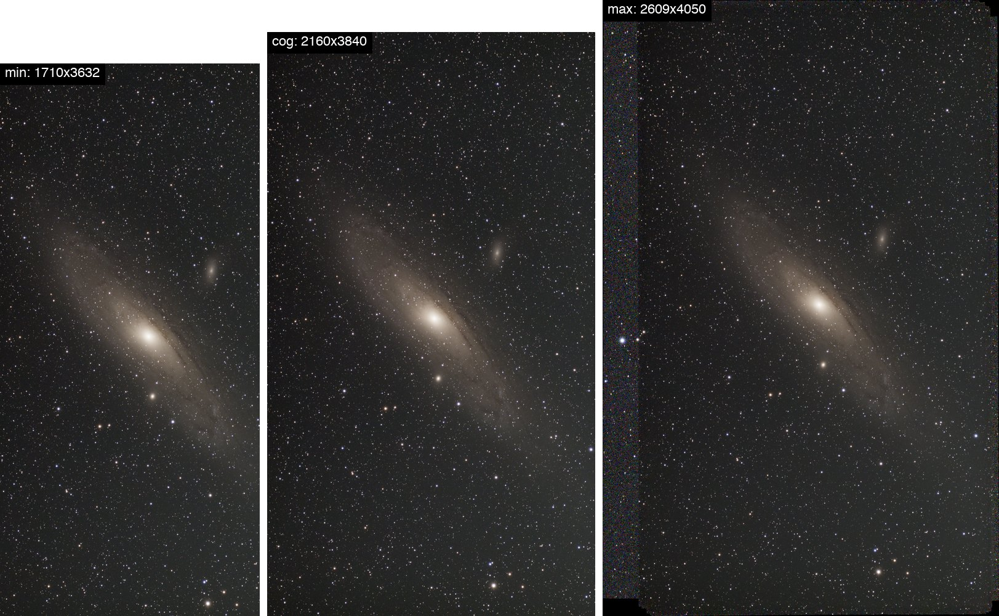
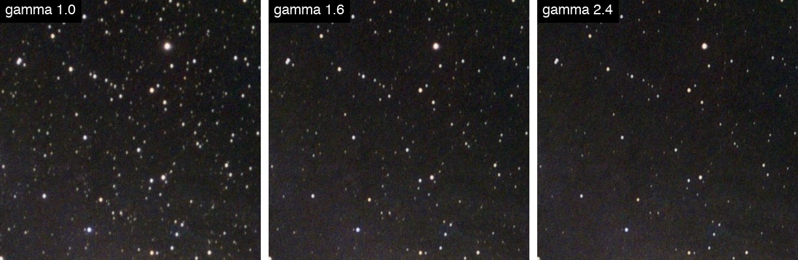

# Configuration

Each work directory has a `darkroom.toml`, written by `darkroom init`. A setting can come from five places. The first one that sets it wins:

1. a command-line flag
2. `darkroom.toml`
3. the look preset (`[target] look`)
4. the camera preset (`[target] camera`)
5. the built-in default

Unknown keys and bad values are errors that name the file and the key. Relative paths are relative to the config file.

`examples/m31.toml` is the configuration behind the M31 image in the README, and `examples/m13.toml` is the one the `cluster` look came from.

## [target]

| Key | Default | Meaning |
|---|---|---|
| `name` | from the FITS `OBJECT` | target name, for your own reference |
| `subs` | none | folder with the light subs |
| `dark` | none | `"auto"` to pick from `dark_library`, `"none"`, or the path of a master dark |
| `dark_library` | none | folder of master darks, used when `dark = "auto"` |
| `camera` | detected by `init` | camera preset name, or the path of your own `.toml` |
| `look` | `galaxy` | look preset name, or the path of your own `.toml` |

### Picking a master dark

With `dark = "auto"`, darkroom looks in the dark library for masters with the same exposure as the subs, keeps the ones with the same gain, and takes the one whose temperature is closest to the subs' median sensor temperature. Ties go to the newest. It prints which dark it chose and warns when the temperature is more than 5 °C off. The library layout is the Seestar's: `<library>/<exposure>s/MasterDark_*.fit`.

The Seestar's sensor is not cooled, so this matters more than it would with a cooled camera. During the M31 session the sensor went from 21.4 °C down to 8.6 °C, and the only master dark had been taken at 21.5 °C. See [master dark temperature](troubleshooting.md#the-master-dark-does-not-match-the-subs) for what that did.

## [stack]

| Key | Default | Meaning |
|---|---|---|
| `framing` | `min` | `min`, `cog` or `max`; see below |
| `keep_fwhm` | 90 | percent of frames kept, sharpest first (weighted FWHM) |
| `keep_round` | 90 | percent of frames kept, roundest stars first |
| `keep_bkg` | 100 (off) | percent of frames kept, darkest sky first |
| `keep_stars` | 100 (off) | percent of frames kept, most stars first |
| `clean` | false | delete `<work>/process` after a successful stack |
| `mosaic` | false (`init` turns it on for a mosaic) | plate-solve every frame and stack them onto one canvas; see [mosaics](usage.md#mosaics) |

### Framing

The Seestar re-centres the target during a session, so the frames do not line up exactly. On the M31 night they wandered by up to 300 pixels. Framing decides what to do with the edges:



`min` keeps only the area every frame covers. It is the cleanest and the narrowest. `cog` keeps a full sensor frame centred on where the frames were on average; on M31 it was 2160×3840 instead of 1710×3632, with edge strips about 20% noisier. `max` keeps the bounding box of all frames (2609×4050). Its edges are ragged and much noisier, about 1% of it is never covered at all, its brightness scale differs from the other two, and it always needs cropping.

To compare framings without restacking from scratch:

```sh
darkroom stack --work m31 --reuse-registration --framing cog --out stack_cog
```

To adopt one, set `[stack] framing` and restack.

With `mosaic = true` the framing is always `max`, followed by a crop to the largest rectangle with data everywhere. A `framing` set to something else is ignored with a warning.

### Frame selection

`keep_fwhm` and `keep_round` drop the blurriest frames and the ones with the most elongated stars. Frames that are fully clouded fail registration and drop out by themselves. `keep_bkg` and `keep_stars` can also drop frames with a bright sky or few stars, which is what thin cloud does to a frame.

Compare before you rely on them. On the M13 data, where thin cloud crossed several frames, dropping the 3 stacked frames with the brightest sky and fewest stars (15 down to 12) left the gradient unchanged and made the stack 6% noisier. Siril's rejection and normalisation had already dealt with the cloud.

## [bge]

| Key | Default | Meaning |
|---|---|---|
| `smoothing` | 0.1 | GraXpert background smoothing |

If `bge_background.fits` shows the outline of the target, the model has taken real signal with it; raise `smoothing`.

## [color]

| Key | Default | Meaning |
|---|---|---|
| `sensor` | `Sony IMX585` | sensor name as Siril's SPCC lists it |
| `filter` | `UV/IR Block` | filter name as Siril's SPCC lists it |
| `focal` | 160 | focal length in mm, for plate solving |
| `pixel` | 2.9 | pixel size in µm, for plate solving |
| `catalog` | `gaia` | Siril's plate-solve catalogue |
| `whiteref` | `Average Spiral Galaxy` | SPCC white reference |
| `catalog_fallback` | true | fetch Gaia DR3 from ESA when Siril's catalogue server is down |

The camera preset sets `sensor`, `filter`, `focal` and `pixel`, and `init` writes the values from the FITS header. The Seestar's IRCUT filter maps to `UV/IR Block` and its LP filter to `ZWO Seestar LP`.

## [denoise]

| Key | Default | Meaning |
|---|---|---|
| `strength` | 0.6 | 0 to 1 |
| `cpu` | false | run on the CPU instead of the Apple GPU (about 15 times slower) |

## [deconv]

Optional deconvolution with GraXpert's object deconvolution model, between `denoise` and `stretch`. It is off by default. It needs GraXpert's model (1.0.1, 279 MB), which `darkroom deconv` has GraXpert download the first time, or `darkroom fetch-models --deconv`; set `DARKROOM_DECONV_MODEL` if the file is somewhere else.

| Key | Default | Meaning |
|---|---|---|
| `strength` | 0 (off) | 0 to 1. At 0 the stage is skipped and `stretch` reads `denoised.fits` |
| `psf` | `auto` | star FWHM in pixels, or `"auto"` to measure it from `denoised.fits` |
| `cpu` | false | run on the CPU instead of the GPU |

Flags: `darkroom deconv --strength 0.5 --psf 3.2 --cpu`; `darkroom run --cpu` also covers this stage. Turning `strength` from 0 to a value, or back, reruns `stretch` and everything after it. Work directories made before this stage existed stay up to date while it is off. Start around 0.3 to 0.5 and compare 1:1 crops before and after: dark rings around bright stars or a crunchy sky mean the strength is too high.

## [stretch]

| Key | Default | Meaning |
|---|---|---|
| `asinh` | 25 | Siril arcsinh stretch factor |
| `shadows` | -2.5 | autostretch shadow clipping, in sigma |
| `target_bg` | 0.10 | autostretch target background level |
| `sat` | 0.35 | Siril saturation amount |

A low `asinh` gives a softer, flatter image with a brighter core. Higher values keep the core resolved and the star colours visible, but too high mottles the sky with colour noise. The galaxy look uses 25; the cluster look uses 100.

## [starnet]

| Key | Default | Meaning |
|---|---|---|
| `dir` | see below | folder with the StarNet command line and its weights |

darkroom looks for StarNet in this order: `--starnet-dir`, `[starnet] dir`, `$DARKROOM_STARNET_DIR`, then the newest StarNet2 installed by `darkroom get-starnet`. A folder with `starnet2` in it is StarNet2 2.6; one with `starnet++` is the older v2.0.2.

## [finish]

| Key | Default | Meaning |
|---|---|---|
| `stars` | `reduce` | `reduce`: StarNet removes the stars, the rest is enhanced, the stars go back smaller. `keep`: no star removal, and StarNet is not run |
| `gamma` | 1.6 | above 1 shrinks stars (star layer only) |
| `star_strength` | 0.95 | brightness of the star layer |
| `mid` | 0.45 | midtone; below 0.5 brightens |
| `sat` | 1.2 | saturation |
| `yb` | 1.8 | yellow and blue contrast inside the target (1 is off) |
| `core` | 0.3 | compress the brightest part of the target, keeping its detail (0 is off) |
| `sharpen` | 0.8 | sharpening of the target |
| `sharpen_radius` | 2.0 | sharpening radius in pixels |
| `black` | 0.02 | black point |
| `erode` | 0 | erosion passes on the star layer |
| `neutral` | true | make the sky colour neutral |
| `crop` | `none` | `none`, pixels `"x,y,w,h"`, or a shape like `"2:3"` |
| `crop_center` | the target | `"x,y"` centre for a shape crop |
| `crop_scale` | 1.0 | fraction of the largest box of that shape |

With `stars = "keep"`, only `mid`, `sat`, `black`, `neutral` and the crop settings apply, to the whole image. The others work on the star layer or inside the target and need StarNet.

### Shrinking stars

The star layer is dimmed with a gamma curve, which takes more off a star's faint halo than off its bright centre. Stars get smaller and fainter, but they all stay:



Past about 2.0 the field starts to look thinned out. `erode` shrinks stars with a minimum filter instead; any value above 0 deletes the faint 1 to 2 pixel stars entirely, which looks fake, so leave it at 0. It is there for completeness.

### Colour and sharpening

`yb` pushes yellow and blue apart inside the target only, which makes a galaxy's warm core and bluer arms easier to tell apart. It is cosmetic, not measured colour. On M31, 1.8 looked right; 2.6 turned the core green-yellow and the arms purple. `sharpen` applies an unsharp mask to the target's brightness, with the sky masked off so its noise is left alone. Too much puts halos along dust lanes.

`core` is for a bright galaxy core that the stretch has pushed close to white. It splits the target's brightness into a smooth base and the detail on top of it, lowers the base where it is above 55% brightness, and keeps the detail, so the core fades smoothly instead of flattening into a white disc. Colours keep their ratios, and nothing below the threshold changes. On M31 at 0.3, no pixel in the centre is clipped any more (before, 7% of the centre 60 pixels across was at 98% brightness or more), M110's core is tamed the same way, and about 2% of the image changes. At 0.4 the core starts to look flat and greyish. It cannot show structure the data does not have: at the Seestar's 4 arcseconds per pixel, M31's core is a smooth bulge.

### Cropping

`crop = "2:3"` takes the largest box of that shape that fits, centred on the brightest part of the blurred image (the starless image, or the stretched one when stars are kept). For a target that is small in the frame, `crop_scale` shrinks that box: M13 used `crop = "1:1"` with `crop_scale = 0.45`. `crop_center = "x,y"` overrides the centre when the brightest point is the wrong place, and `"x,y,w,h"` crops by pixels.

## Looks

A look is a preset for `[stretch]` and `[finish]` (and the SPCC white reference). Two are shipped, in `presets/looks/`:

- `galaxy`, the default, comes from M31. StarNet removes the stars, the galaxy is enhanced, and the stars go back smaller.
- `cluster` comes from M13 and is for targets made of stars. StarNet would remove the target itself and star reduction would dim it, so this look keeps the stars and skips StarNet. It stretches harder (`asinh = 100`) to keep the core resolved, and uses `sat = 1.3` and `black = 0.04`.

Each look was made from a single image, and the cluster look from only 7.5 minutes of data. If you are not sure which one a target needs, run the galaxy look once and open `starless.tif`: if the target has gone from it, use `stars = "keep"`. A nebula has no look yet.

To make your own, copy a file from `presets/looks/`, change it, and point `look` at its path.

## Cameras

Two camera presets are shipped: `seestar-s30-pro` (160 mm, Sony IMX585) and `seestar-s30` for the original S30 (150 mm, Siril's `ZWO Seestar S30` sensor entry). `init` detects them from the `CREATOR` keyword in the FITS header; a preset whose text equals the header value wins, otherwise the longest matching text, so S30 Pro subs never get the S30 preset. Besides the `[color]` values, each records the Bayer pattern (GRBG), which files count as subs (`Light_*.fit`), how the Seestar names master darks, and the filter-name mapping.
