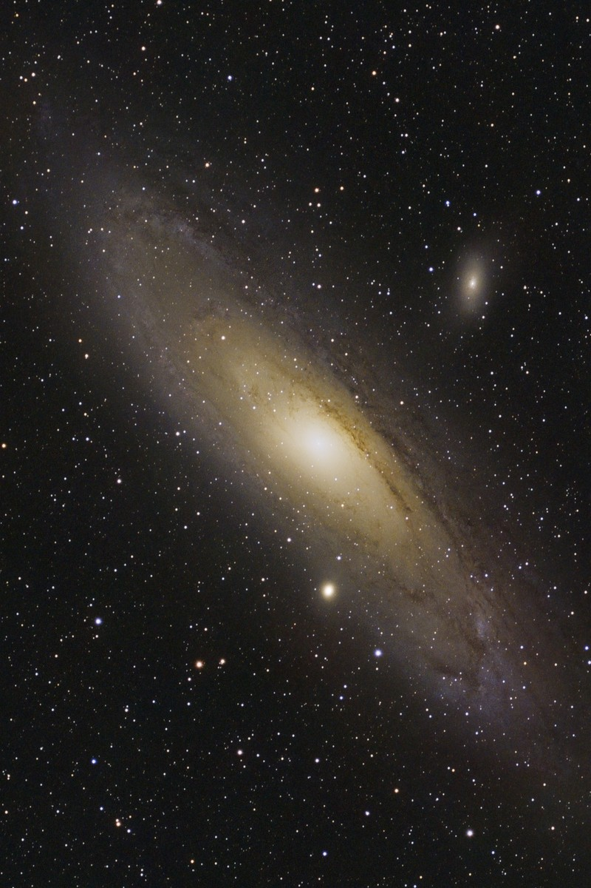
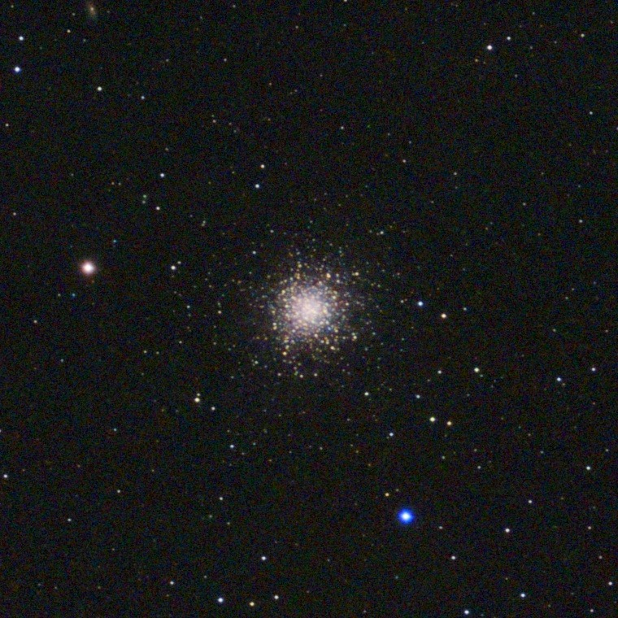

# Gallery

Targets processed with darkroom, with the settings that differ from the defaults. Every image here is a JPEG rebuilt from pixel data, with no metadata.

## M31, the Andromeda Galaxy

ZWO Seestar S30 Pro at gain 200: two nights, 734 subs of 30 s, 6 h 7 min in total (see [two nights](#two-nights) below). Galaxy look, `crop = "2:3"`, and the optional deconvolution stage at `strength = 0.5` with the PSF measured from the image (2.5 px).

Full-size crops of the core, the dust lanes beside it and M110 from the first night alone, before and after the two additions from November 2026. Core compression (`[finish] core = 0.3`, now the galaxy look's default) leaves no pixel in the centre clipped; before it, 7% of the centre 60 pixels across was at 98% brightness or more. Deconvolution makes the dust lanes and stars slightly crisper. The blotchy texture in the faint outer disk is still there in both: it comes from too little integration time, and a stronger denoise did not remove it. See [history](history.md#core-compression).

### Two nights

The first night (15 November) gave 404 subs of 30 s under a dark sky, all of them usable. The second (20 November) gave 827, under an 84% Moon 34° from M31: the sky was 1.6 to 2 times brighter, each frame about 30% noisier, and stars about 15% wider (5.2 against 4.5 pixels). Every sub was scored for M31's altitude, the Sun's altitude, sky level, noise, star count and star size. All 404 from the first night and the 487 from the second taken before M31 dropped below 35° went into one folder; after that the star count halved and the last frames were in dawn light. Siril kept 734 of the 891, 6 h 7 min in total.

Against the first night alone, the signal-to-noise ratio of the stack rose by about 18%: from 5.6 to 6.6 in the faint outer disk and from 19.5 to 23.2 in the bright disk. The moonlit frames count for less than dark ones, so this is less than the 30% the sky noise alone predicted. The outer disk is a little smoother, with less colour mottling; at the size of the image above the two versions are hard to tell apart. Colour calibration matched the first night's (factors 0.715 / 1.000 / 0.956). The area both nights cover is about 7% smaller than one night's, so the 2:3 crop is too.

## M13, the Hercules Cluster

ZWO Seestar S30 Pro: 15 of 18 subs of 30 s, 7.5 minutes in total, cut short by cloud. Cluster look, which keeps the stars and skips StarNet; `crop = "1:1"` with `crop_scale = 0.45`, because the cluster is small in the frame. With so little integration time the sky is noisy at full size.
